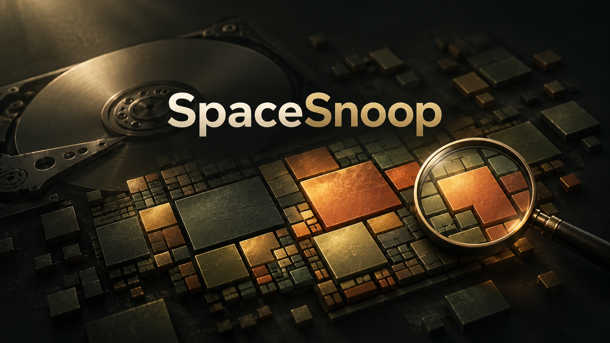
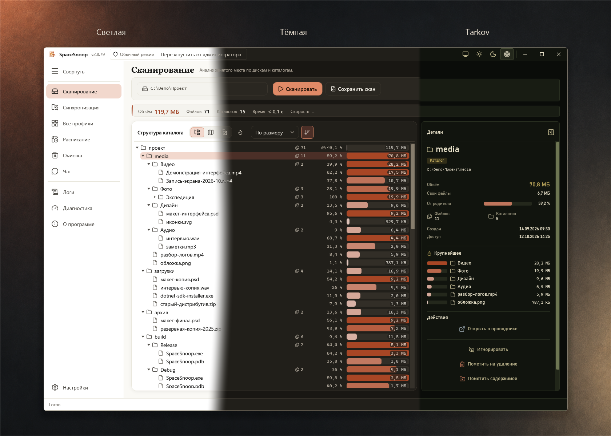
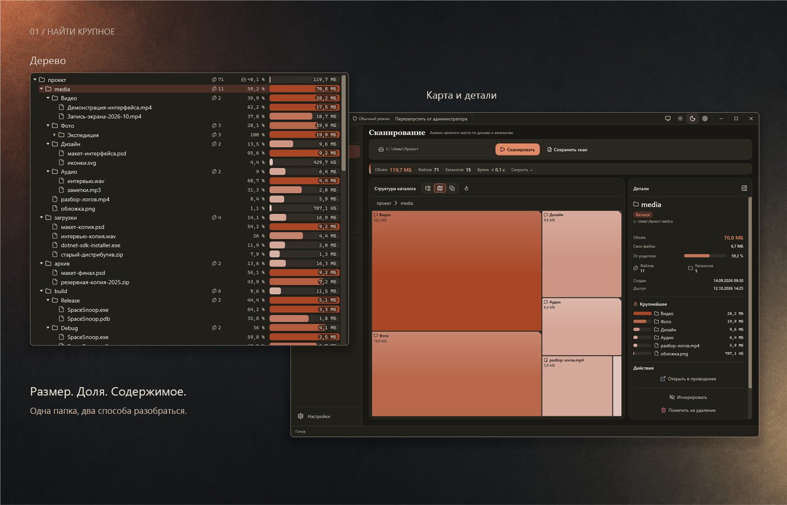
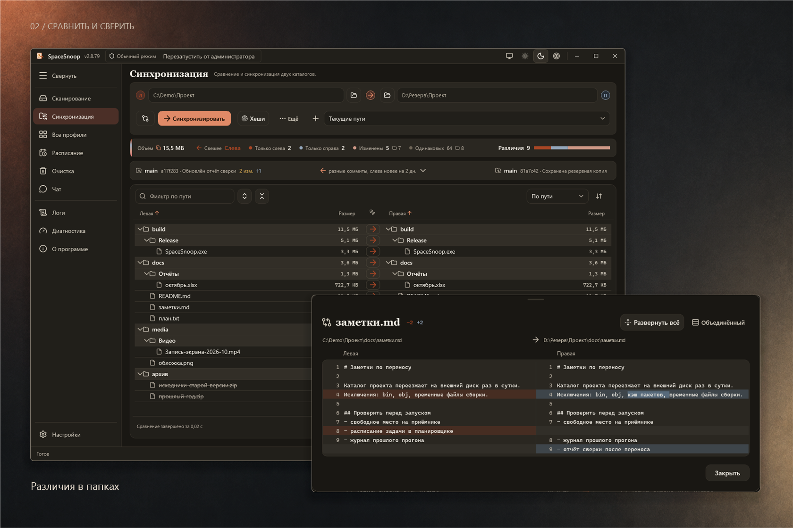
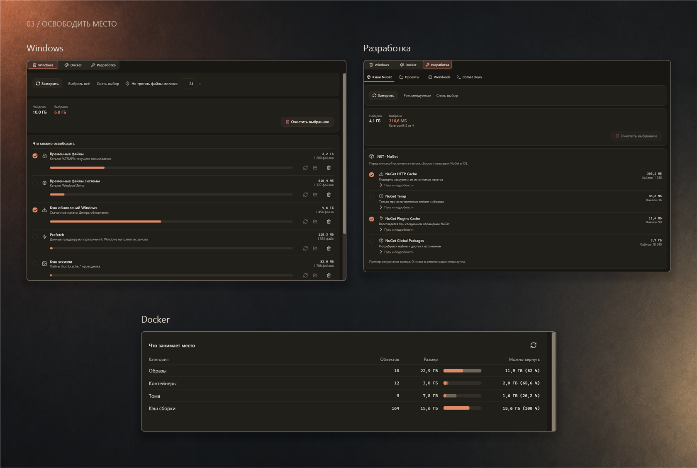
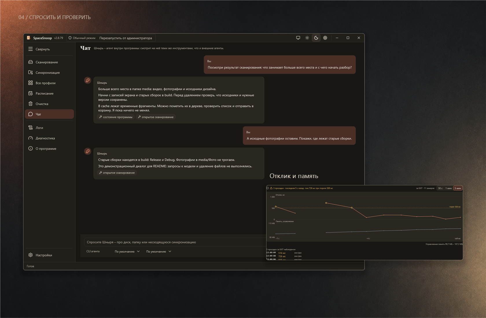

# SpaceSnoop



### Диск опять забит, а чем – непонятно?

Винт забит под завязку. Где-то лежит старый бэкап на 80 ГБ, Docker жрёт диск как не в себя,
а проводник показывает папки по одной. Складывать размеры в уме – так себе развлечение.

SpaceSnoop – шнырь по твоим накопителям. Сканирует диск или папку и красит самое жирное красным:
вот бэкап, вот забытые образы, а вот проект, который оброс гигабайтами сборочного мусора.
Нашёл хлам – пометил, проверил список, отправил в корзину. Бонусом – сравнение папок,
синхронизация, очистка кэшей и чат со Шнырём, если копаться самому лень.

[](https://github.com/MaxNagibator/SpaceSnoop/actions/workflows/release.yml)


**[Скачать для Windows](https://github.com/MaxNagibator/SpaceSnoop/releases)** · [Начать работу](#начать-работу) · [Руководство](GUIDE.md) · [Все скриншоты](assets/screenshots/README.md)



*Светлая, тёмная и Tarkov. Режим «Как в системе» следует за Windows. Композиция собрана из настоящих снимков; [каждая тема отдельно](assets/screenshots/README.md).*

## Найти, чем занят диск

Выбираешь диск или папку – получаешь дерево с тепловой подсветкой: зелёное – мелочь, красное – вот оно.
Хочешь увидеть всё разом – переключись на карту: чем жирнее папка, тем больше прямоугольник.
Справа – свои файлы, вложения, доли и даты. Двойной клик ведёт глубже, хлебные крошки возвращают назад.



Папка нужная, но заслоняет остальное? **Игнорируй** её: останется на месте, из подсчёта уйдёт.
Одинаковые файлы собираются в группы дубликатов. Старый проект можно упаковать в ZIP:
перед отправкой оригинала в корзину приложение проверит архив и убедится, что ничего не потерялось.
Всё дерево можно выгрузить в JSON, если хочется покопаться в цифрах самому.

[Режимы сканирования и их ограничения →](GUIDE.md#возможности)

## Миллионы файлов за несколько секунд

Диск целиком можно не обходить папку за папкой, а прочитать главную файловую таблицу NTFS (MFT) напрямую.
В октябре 2026 года погоняли **SpaceSnoop 2.8.77** и **WizTree 4.33 x64** на одном системном
диске с **3 463 807 файлами**. Оба читали MFT, так что обычный обход тут ни при чём.

| Замер | SpaceSnoop | WizTree | Соотношение времени |
| --- | --- | --- | --- |
| Первый тест | **2,40 с** | 4,61 с | **1,92×** |
| По видеозаписи, до готового результата на экране | **2,45 с** | 7,59 с | **3,10×** |

Оба раза SpaceSnoop закончил раньше. Но это два замера на одном диске: кеш Windows, фоновая нагрузка
и порядок запуска могут сдвинуть цифры. Да и насчитали программы разное – быстрее ещё не значит,
что посчитали одно и то же.
[Условия сравнения и трактовка размеров →](GUIDE.md#производительность-и-сравнение)

## Привести папки к одному состоянию

Рабочая папка тут, копия там, а где свежее – уже не помнишь? Сравнение покажет, что изменилось,
что пропало и что конфликтует. Перед переносом виден план действий; текстовые файлы можно
разобрать построчно. Для репозиториев рядом ещё и состояние Git.



Сохрани пары папок в профили – страница «Все профили» сравнит их пачкой и покажет, где данные свежее.
А чтобы не вспоминать про копирование каждый вечер, поставь синхронизацию на расписание.
Её запустит Планировщик Windows, держать приложение открытым не надо.

[Синхронизация, профили и расписание →](GUIDE.md#синхронизация)

## Освободить место осознанно

Кэши копятся тихо, а потом внезапно занимают полдиска. Здесь сначала считаешь, сколько нажили,
выбираешь лишнее и подтверждаешь очистку. У каждой кучи свои правила.



- **Windows**: временные файлы, кэши обновлений и эскизов, Prefetch, дампы и корзина. Молодые файлы защищены порогом возраста; `Windows.old` открывается в штатном средстве Windows.
- **Docker**: образы, контейнеры, тома и кэш сборки; отдельные объекты и сжатие диска данных Docker Desktop.
- **Разработка**: кэши NuGet, артефакты проектов, обслуживание workloads .NET и `dotnet clean` для явно доверенного проекта.

Очистка Windows, NuGet и Docker безвозвратна. Артефакты проектов отправляются в корзину;
MSBuild и обслуживание workloads не обеспечивают откат. [Подробнее об удалении →](#что-попадёт-в-корзину)

## Спросить Шныря и проверить результат

Копаться самому лень – спроси Шныря. В приложении живёт чат с агентом поверх твоего же
Claude Code, Codex или OpenCode. Через MCP он посмотрит скан и сравнение, разберёт, куда ушло место.
Перед отправкой данных спросит согласие. Чтобы он мог что-то менять, изменяющие операции нужно включить отдельно.



Если что-то тормозит или отвалилось, в диагностике есть отклик интерфейса, память и последняя операция,
а в логах – что происходило перед этим. Пакет диагностики соберёт данные для поддержки,
убрав секреты и заменив личные пути.

[Чат, MCP и диагностика →](GUIDE.md#чат-с-агентом)

## Начать работу

1. Скачай **SpaceSnoop (WPF)** из [Releases](https://github.com/MaxNagibator/SpaceSnoop/releases). Portable содержит рантайм; обычному EXE нужен [.NET 10 Desktop Runtime](https://dotnet.microsoft.com/download/dotnet/10.0).
2. Выбери диск или папку на странице «Сканирование». Для системных каталогов и чтения таблицы NTFS нужны права администратора; обычный обход работает и без них, но может быть неполным.
3. Разбери крупные папки. Пометка ещё ничего не удаляет: проверь список и режим перед нажатием «Удалить».

Настройки хранятся в `settings.toml`, по умолчанию в `%LOCALAPPDATA%\SpaceSnoop`.
Место хранения можно переключить на portable рядом с EXE. Масштаб шрифта меняется от 80 до 160 %.

## Что попадёт в корзину

| Действие | Что происходит |
| --- | --- |
| Удаление помеченного в скане | Корзина по умолчанию. В настройках есть безвозвратный режим. |
| Упаковка папки в ZIP | Оригинал идёт в корзину после проверки архива и покрытия, если включена эта настройка. |
| Синхронизация | Удаляемое идёт в корзину. Сохранение затираемых файлов включено по умолчанию и настраивается отдельно. |
| Артефакты проектов | Корзина с данными для восстановления исходных путей. |
| Windows, NuGet и Docker | Безвозвратная очистка после подтверждения. |
| Workloads и доверенный `dotnet clean` | Изменения через .NET CLI / MSBuild, корзина не обеспечивает откат. |

Итог скана – **логические размеры файлов**, а не занятые кластеры. Жёсткие ссылки, сжатие
и разреженные файлы могут давать расхождение с цифрами Windows.
[Почему размеры различаются и как восстановить удалённое →](GUIDE.md#faq)

## WPF или Classic

Две морды: новая на WPF и старая на WinForms. WPF умеет всё, что показано выше.
**Classic** – если нужен просто скан, пометки, сравнение и синхронизация, а новое не любишь.
Под капотом общая логика SpaceSnoop.Core. Обе – только для Windows.

## Собрать из исходников

Нужны Windows и .NET SDK **10.0.302**, закреплённый в `global.json`.
KeepShell восстанавливается из каталога `packages`, остальные зависимости – из NuGet.

```powershell
dotnet restore SpaceSnoop.sln --locked-mode
dotnet run --project SpaceSnoop.Wpf/SpaceSnoop.Wpf.csproj --no-restore
```

Для Classic выбери `SpaceSnoop/SpaceSnoop.csproj`. Проверка решения: `dotnet test SpaceSnoop.sln --no-restore`.

---

[Что нового](CHANGELOG.md) · [Подробное руководство](GUIDE.md) · [Галерея всех экранов](assets/screenshots/README.md) · [Сообщить о проблеме](https://github.com/MaxNagibator/SpaceSnoop/issues)

*Твой диск что-то скрывает. Пора пошнырять.*
